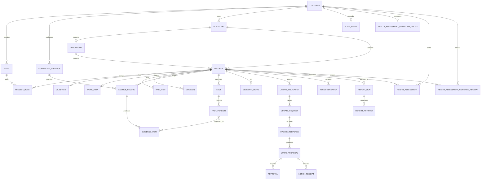

# Data Model

## Data-model principles

- Use stable internal UUIDs.
- Retain external source IDs separately.
- Version material facts.
- Keep current projections for fast reads and history for audit.
- Store structured facts as typed columns or validated JSON where appropriate.
- Use embeddings only for unstructured retrieval.
- Treat source content as untrusted.
- Avoid database structures tied to one customer’s Jira configuration.

## High-level entity model

## Core tables

### `projects`

Suggested fields:

- `id`
- `customer_id`
- `portfolio_id`
- `programme_id`
- `project_code`
- `name`
- `description`
- `workstream`
- `business_unit`
- `sponsor_id`
- `project_manager_id`
- `priority`
- `business_impact`
- `effort_size`
- `phase`
- `lifecycle_status`
- `baseline_start_date`
- `baseline_end_date`
- `forecast_end_date`
- `actual_end_date`
- `reported_rag`
- `management_attention_state`
- `last_verified_at`
- `created_at`
- `updated_at`

### `source_records`

- `id`
- `connector_instance_id`
- `external_type`
- `external_id`
- `external_url`
- `external_revision`
- `project_id`
- `normalized_hash`
- `observed_at`
- `source_updated_at`
- `raw_payload_reference`
- `deleted_at`

Do not store entire sensitive raw payloads by default when normalized facts are sufficient.

### `facts`

- `id`
- `customer_id`
- `project_id`
- `fact_type`
- `subject_type`
- `subject_id`
- `current_version_id`
- `authority_rule_id`
- `created_at`

### `fact_versions`

- `id`
- `fact_id`
- `value_json`
- `provenance` (immutable origin; ADR-009)
- `confidence`
- `effective_at`
- `observed_at`
- `verified_at`
- `valid_until`
- `provided_by_user_id`
- `source_record_id`
- `supersedes_version_id`
- `approval_id`
- `created_at`

### `evidence_items`

- `id`
- `customer_id`
- `project_id`
- `source_record_id`
- `evidence_type`
- `title`
- `content_reference`
- `content_hash`
- `excerpt`
- `occurred_at`
- `observed_at`
- `access_classification`
- `embedding`
- `metadata_json`

### `update_obligations`

- `id`
- `project_id`
- `policy_id`
- `responsible_user_id`
- `due_at`
- `state`
- `required_fact_types`
- `last_request_at`
- `next_action_at`
- `satisfied_at`
- `closed_reason`
- `version`

### `update_requests`

- `id`
- `obligation_id`
- `channel`
- `recipient`
- `message_version`
- `sent_at`
- `delivery_status`
- `correlation_id`

### `update_responses`

- `id`
- `request_id`
- `provided_by_user_id`
- `raw_text`
- `received_at`
- `structured_interpretation_json`
- `interpretation_status`
- `confirmed_at`
- `evidence_item_id`

### `write_proposals`

- `id`
- `project_id`
- `target_connector_id`
- `target_record_id`
- `operation`
- `current_value_json`
- `current_revision`
- `proposed_value_json`
- `reason`
- `risk_class`
- `state`
- `expires_at`
- `idempotency_key`
- `created_by_type`
- `created_by_id`
- `created_at`

### `approvals`

- `id`
- `proposal_id`
- `approver_user_id`
- `decision`
- `comment`
- `proposal_revision`
- `decided_at`

### `action_receipts`

- `id`
- `proposal_id`
- `attempt`
- `executing_identity`
- `started_at`
- `completed_at`
- `result`
- `external_revision`
- `external_response_reference`
- `error_class`
- `correlation_id`

### `delivery_signals`

- `id`
- `project_id`
- `signal_type`
- `severity`
- `input_facts_json`
- `rule_id`
- `rule_version`
- `explanation`
- `detected_at`
- `resolved_at`

### `audit_events`

- `id`
- `customer_id`
- `project_id`
- `actor_type`
- `actor_id`
- `event_type`
- `object_type`
- `object_id`
- `summary`
- `metadata_json`
- `correlation_id`
- `occurred_at`

## Data integrity

- Unique external record by connector, type and external ID.
- Unique event receipt by connector and external event ID.
- Unique action execution by idempotency key.
- Optimistic version on update obligations and proposals.
- Foreign-key restrictions around audit and receipt deletion.
- Check constraints for provenance and state values; assessed freshness/conflict are derived or frozen with as-of time and policy revision.
- Tenant/customer key included in every business table.
- Project scope verified before joining evidence into user-facing queries.

## Storage for unstructured content

Release 1 may store small permitted excerpts in PostgreSQL. Larger documents or source payloads should use customer-controlled object storage with encrypted references.

## Embeddings

Embeddings may support retrieval for:

- Comments
- Meeting notes
- Email
- Report narratives
- Documents

Embeddings must not determine permissions, source authority or current structured facts.

## Orthogonal fact state (ADR-009)

Persist provenance on each immutable fact version as SYSTEM_VERIFIED,
HUMAN_CONFIRMED, AGENT_INFERENCE or UNKNOWN. It records origin, so it survives
expiry and contradictory evidence. Calculate freshness (CURRENT, STALE, UNKNOWN)
and conflict (NONE, CONFLICTING) separately using policy and an explicit as-of time.
Never mutate a historical version just because time passes. Freeze these assessed
dimensions, the policy revision and as-of time in a report/answer claim.

A primary display classification is CONFLICTING when unresolved, otherwise STALE
when expired, otherwise UNKNOWN when freshness is unknown, otherwise provenance.
Show all dimensions alongside that label. Only current, unconflicted,
authority-permitted SYSTEM_VERIFIED or HUMAN_CONFIRMED claims may be presented as
settled facts. Human confirmation establishes attribution; it does not override
source authority. A stale, conflicting human statement retains all three states.

## Stored deterministic schedule health assessment

The incremental AC-HLT-004 implementation stores an immutable, project-scoped
assessment containing the bounded evaluator input, result, rule revision,
envelope hash and absolute content/audit expiry deadlines. The input reads only
reported project status and sealed milestone/work-item schedule fields; source
mappings, import proposals and connector payloads are excluded. The API labels
the result `SCHEDULE_ONLY` and keeps reported and calculated RAG separate.

`HealthAssessmentRetentionPolicy` stores independently configured content,
audit and idempotency windows. Each retention-change audit event carries the
audit window selected for that revision and expires from its recorded event time;
the nullable current-event pointer is cleared before that event is deleted.
`HealthAssessmentCommandReceipt` stores a hashed command key and survives
assessment tombstone purge through its configured retry horizon. Only the worker
role can execute the fixed-scope retention procedure; ordinary API access cannot
update or delete assessment history. Assessment availability and expiry are
rechecked against current project grants on every read. This increment does not
establish source authority or accept AC-HLT-004.

## Trusted CSV comparison storage candidate

FR-CON-006/007/012 and NFR-SEC-001: migration 28 adds `IngestionCsvHead` and
`IngestionCsvContext` as specified in
[EXEC-009 trusted baseline](../04-delivery/exec-plans/EXEC-009-trusted-csv-baseline.md).
The candidate is subject to native, upgrade, recovery and exact-candidate gates.
It preserves every released migration and adds no canonical fact publication.

Migration 28 also widens `IngestionExternalRecord.recordType` from 267 to 268
characters so the approved 256-character sheet and `spreadsheet:` prefix fit.
Receipt domain, wire and browser bounds match; sheet input remains at 256.

The head pins an immutable activation configuration, mapping dictionary and
readiness classification. Its only mutable fields are the monotonic revision,
current context receipt, canonical hash and cumulative byte counter. Each
immutable preview context names its exact predecessor and the complete sorted
cohort of hashed identities, record/project IDs and per-field projection IDs.
There are no duplicate proposal values, raw CSV keys, filenames or raw cells in
comparison storage. Proposal content retains its existing expiry and redaction.

Native guards independently prove current scope, mapping, retained content,
classification and the exact cumulative overlay. Deferred constraints reject
missing contexts, orphan successors or unapplied head advances. Historical
validators remain independent of live plaintext, grants and time, so lawful
redaction does not invalidate immutable command history. Restore validates every
head/context and detects a missing head on an empty current CSV source.

Migration 29 reduces work in the existing validators. A receipt with zero
accepted outcomes carries forward the already validated predecessor rows.
Receipts with accepted outcomes use the full overlay, including accepted
identities with zero fields. The live guard also indexes the validated mapping
dictionary once per context for its retained proposal type checks. Each receipt
still persists and charges the complete context and passes the existing scope,
lineage, binding, retention and completeness checks.

The canonical codec checks each reference's type and length, then looks up
its exact decimal index among the keys of the validated field dictionary.
It compares each canonical index with its immediate predecessor at the same
identity and checks the UUID grammar once per distinct projection string.
The codec renders the two validated arrays directly into the existing canonical
text format. The native guard and validator reuse the verified bytes and digest
within a call when the predecessor rows are identical.

The cohort is bounded at 1,000 identities, 32 fields and 100 projects; each
canonical state is bounded at 2 MiB. A source retains at most 4,096 contexts and
256 MiB of canonical state, with a 4 MiB union of required full content arrays.
Overflow, incompatible mapping/scope or unavailable required content rejects a
new comparison. Existing unordered history is `LEGACY_UNAVAILABLE`; dates and
UUIDs never manufacture an order or reset permission. A previous configured
project remains in comparison scope even when it had no observed row.

The API role has SELECT/INSERT on the two tables and only the four approved
head UPDATE columns. Four pure/read validators are executable; mutation and
completion guards remain private. Backup has SELECT only and the worker has
no access. Recovery reconstructs table, column and function privileges after
`--no-acl` restore before the quarantined target can be used.
